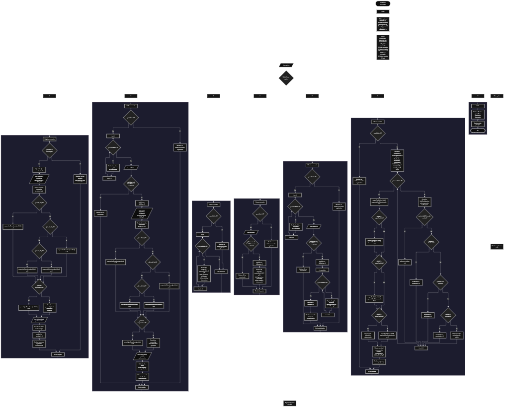

Este proyecto, llamado <b>análisis de encuestas</b>, fue desarrollado en <b>visual basic .net</b> como un ejercicio práctico para fortalecer la lógica de programación mediante la creación de un sistema de gestión y análisis de encuestas desde la consola. El programa cuenta con un menú principal de siete opciones que permite <b>registrar, editar, eliminar, buscar, listar y analizar</b> las encuestas almacenadas. Cada encuesta contiene información como la pregunta, las cantidades de respuestas A, B, C y D, el total de respuestas, la alternativa ganadora, su porcentaje, la fecha, el estado y las observaciones. Para administrar la información se utilizan <b>12 arreglos paralelos con una capacidad máxima de 10 encuestas durante la ejecución</b>. Además, el sistema realiza cálculos automáticos para identificar las respuestas ganadoras y obtener estadísticas generales sobre los participantes, las alternativas seleccionadas y los estados de las encuestas. Durante su desarrollo se aplicaron conceptos fundamentales de programación, como variables, arreglos, estructuras condicionales, ciclos repetitivos, estructuras de selección, contadores, acumuladores y operaciones aritméticas.

<h2 align="center">⚙️ Funcionamiento del menú principal</h2>

### ➕ Registrar encuesta

La opción <b>1) registrar encuesta</b> permite almacenar una nueva encuesta en el sistema. Antes de realizar el registro, el programa comprueba que la cantidad de encuestas almacenadas sea menor que la capacidad máxima de los arreglos mediante la condición <b>cantidad &lt; ids.Length</b>. Si existe espacio disponible, asigna un identificador utilizando <b>ids(cantidad) = cantidad + 1</b> y solicita la <b>pregunta, las cantidades de respuestas A, B, C y D, la fecha, el estado y la observación</b>. Después de introducir las cantidades de respuestas, calcula automáticamente el total mediante la suma de las cuatro alternativas y determina cuál tiene la mayor cantidad utilizando estructuras <b>If, ElseIf y Else</b>. A continuación, comprueba si el total de respuestas es mayor que cero para calcular el porcentaje de la alternativa ganadora mediante la fórmula <b>(respuestas ganadoras * 100) / total de respuestas</b>. Si no existen respuestas, asigna el porcentaje <b>0</b>. Finalmente, incrementa la variable <b>cantidad</b> en uno y muestra el mensaje <b>"Encuesta registrada correctamente."</b>. Si se alcanza la capacidad máxima, muestra el mensaje <b>"No hay espacio para registrar mas encuestas."</b> e impide agregar otro registro.

### ✏️ Editar encuesta

La opción <b>2) editar encuesta</b> permite modificar la información de una encuesta registrada. Primero, el programa comprueba si existen encuestas almacenadas mediante la variable <b>cantidad</b>. Si no hay registros, muestra el mensaje <b>"No existen encuestas registradas."</b>. En caso contrario, presenta una lista con la información de todas las encuestas, incluyendo sus identificadores, preguntas, cantidades de respuestas, totales, alternativas ganadoras, porcentajes, fechas, estados y observaciones. Después, solicita el identificador de la encuesta que se desea editar y comprueba que se encuentre dentro del rango permitido mediante la condición <b>idEditar &gt;= 1 And idEditar &lt;= cantidad</b>. Si el identificador es válido, calcula la posición correspondiente mediante <b>posicion = idEditar - 1</b> y solicita la nueva pregunta y las nuevas cantidades de respuestas A, B, C y D. Posteriormente, vuelve a calcular el total de respuestas, determina la nueva alternativa ganadora y actualiza su porcentaje, considerando también el caso en que el total sea cero. Finalmente, solicita la nueva fecha, el nuevo estado y la nueva observación, actualiza los arreglos correspondientes y muestra el mensaje <b>"Encuesta actualizada correctamente."</b>. Si el identificador no corresponde a una encuesta registrada, presenta el mensaje <b>"ID no encontrada."</b>.

### 📋 Listar encuestas

La opción <b>3) listar encuestas</b> permite visualizar todos los registros almacenados actualmente en el sistema. Antes de mostrar la información, el programa comprueba si la variable <b>cantidad</b> es igual a cero. Si no existen encuestas registradas, presenta el mensaje <b>"No existen encuestas registradas."</b>. Si hay registros disponibles, utiliza un ciclo <b>For</b> para recorrer los arreglos desde la posición inicial hasta la última encuesta registrada. Durante el recorrido, muestra el identificador, la pregunta, las cantidades de respuestas A, B, C y D, el total de respuestas, la alternativa ganadora, el porcentaje ganador, la fecha, el estado y la observación de cada encuesta. Esta función permite consultar todos los registros almacenados sin necesidad de buscar cada encuesta individualmente.

### 🔎 Buscar encuesta

La opción <b>4) buscar encuesta</b> permite localizar una encuesta mediante su identificador. Primero, el programa comprueba si existen encuestas registradas. Si la cantidad es igual a cero, muestra el mensaje <b>"No existen encuestas registradas."</b>. En caso contrario, solicita el identificador de la encuesta que se desea buscar y verifica que se encuentre dentro del rango permitido mediante la condición <b>idBuscar &gt;= 1 And idBuscar &lt;= cantidad</b>. Si el identificador es válido, calcula la posición correspondiente mediante <b>posicion = idBuscar - 1</b> y muestra toda la información de la encuesta seleccionada: identificador, pregunta, cantidades de respuestas, total, alternativa ganadora, porcentaje, fecha, estado y observación. Si el identificador introducido no corresponde a una encuesta registrada, presenta el mensaje <b>"ID no encontrada."</b>.

### 🗑️ Eliminar encuesta

La opción <b>5) eliminar encuesta</b> permite eliminar una encuesta registrada mediante su identificador. Antes de comenzar, el programa comprueba si existen encuestas almacenadas. Si no hay registros, muestra el mensaje <b>"No existen encuestas registradas."</b>. Si existen encuestas, presenta una lista con toda la información almacenada y solicita el identificador de la encuesta que se desea eliminar. Después, comprueba que el identificador esté dentro del rango permitido. Si es válido, calcula su posición mediante <b>posicion = idEliminar - 1</b> y comienza el proceso de eliminación utilizando un ciclo <b>For</b> controlado por la variable <b>i</b>. Durante cada repetición, desplaza una posición hacia la izquierda los datos de los registros posteriores en los 12 arreglos: <b>ids, preguntas, respuestasA, respuestasB, respuestasC, respuestasD, totalesRespuestas, respuestasGanadoras, porcentajesGanadores, fechas, estados y observaciones</b>. Finalmente, disminuye la variable <b>cantidad</b> en uno y muestra el mensaje <b>"Encuesta eliminada correctamente."</b>. Si el identificador no corresponde a una encuesta registrada, presenta el mensaje <b>"ID no encontrada."</b>.

### 📊 Mostrar análisis

La opción <b>6) mostrar análisis</b> permite obtener un resumen estadístico general de todas las encuestas registradas. Primero, el programa comprueba si existen registros almacenados. Si la cantidad es igual a cero, muestra el mensaje <b>"No existen encuestas registradas."</b>. En caso contrario, inicializa los contadores <b>activas, finalizadas, enProceso y canceladas</b>, además de los acumuladores <b>totalParticipantes, totalA, totalB, totalC y totalD</b>, todos con valor cero. Después, utiliza un ciclo <b>For</b> para recorrer las encuestas y sumar el total de participantes y las cantidades correspondientes a cada alternativa. Durante el mismo recorrido, analiza los estados mediante <b>ToLower()</b> para contabilizar las encuestas activas, finalizadas, en proceso y canceladas, sin distinguir entre mayúsculas y minúsculas. Al terminar el recorrido, compara los acumulados de las alternativas A, B, C y D para identificar cuál fue la respuesta más seleccionada en el conjunto de encuestas. Finalmente, muestra un resumen con la cantidad de encuestas, los contadores de estados, el total de participantes, las cantidades acumuladas de cada alternativa y la respuesta más seleccionada.

### 🚪 Salir del menú principal

La opción <b>7) salir</b> permite finalizar la ejecución del programa y muestra el mensaje <b>"Gracias por utilizar Analisis de Encuestas."</b>. El menú principal se encuentra dentro de una estructura repetitiva <b>Do...Loop While</b>, que mantiene el programa en funcionamiento mientras la opción seleccionada sea diferente de <b>7</b>. Cuando el usuario selecciona esta opción, se ejecuta el mensaje de despedida y la condición <b>opcion &lt;&gt; 7</b> deja de cumplirse, finalizando correctamente el ciclo principal.

<h2 align="center">🧠 Temas aplicados en el proyecto</h2>

### 📦 Variables

En este proyecto se utilizan variables para controlar la cantidad de encuestas registradas, almacenar la opción seleccionada en el menú, recorrer los arreglos, identificar la posición de una encuesta y realizar los cálculos estadísticos. También se utilizan variables auxiliares para almacenar los contadores de estados, acumular las respuestas de cada alternativa y determinar cuál fue la respuesta más seleccionada en el análisis general. Cada variable cumple una función específica dentro de las operaciones de gestión y procesamiento de encuestas.

🔢 **Opcion:** Almacena la opción seleccionada por el usuario en el menú principal.

📊 **Cantidad:** Controla el número actual de encuestas registradas.

🔄 **I:** Funciona como contador en los ciclos `For` utilizados para recorrer los arreglos y procesar las encuestas.

📍 **Posicion:** Almacena la posición correspondiente a la encuesta seleccionada mediante su identificador.

🆔 **IdEditar:** Almacena el identificador de la encuesta que se desea modificar.

🔎 **IdBuscar:** Almacena el identificador de la encuesta que se desea consultar.

🗑️ **IdEliminar:** Almacena el identificador de la encuesta que se desea eliminar.

📈 **Activ​as, Finalizadas, EnProceso y Canceladas:** Contabilizan las encuestas según su estado.

👥 **TotalParticipantes:** Acumula la cantidad total de respuestas de todas las encuestas.

🔢 **TotalA, TotalB, TotalC y TotalD:** Acumulan las respuestas de cada alternativa.

🏆 **RespuestaMasSeleccionada:** Almacena la alternativa que obtiene la mayor cantidad de respuestas acumuladas.

📊 **MayorCantidad:** Guarda la cantidad más alta encontrada durante la comparación de las alternativas.

### 🗃️ Arreglos

En este proyecto se utilizan <b>12 arreglos paralelos</b> relacionados con la información de cada encuesta. Cada arreglo tiene una capacidad de <b>10 posiciones</b> y utiliza el mismo índice para representar los datos correspondientes a un mismo registro. Por ejemplo, la información de una encuesta almacenada en la posición <b>0</b> se encuentra distribuida entre <b>ids(0), preguntas(0), respuestasA(0), respuestasB(0), respuestasC(0), respuestasD(0), totalesRespuestas(0), respuestasGanadoras(0), porcentajesGanadores(0), fechas(0), estados(0) y observaciones(0)</b>. Esta organización permite registrar, consultar, modificar, analizar y eliminar las encuestas de manera ordenada.

🆔 **Ids(10):** Almacena los identificadores de las encuestas registradas.

📝 **Preguntas(10):** Guarda las preguntas correspondientes a cada encuesta.

🔵 **RespuestasA(10):** Almacena la cantidad de respuestas de la alternativa A.

🟢 **RespuestasB(10):** Almacena la cantidad de respuestas de la alternativa B.

🟡 **RespuestasC(10):** Almacena la cantidad de respuestas de la alternativa C.

🔴 **RespuestasD(10):** Almacena la cantidad de respuestas de la alternativa D.

➕ **TotalesRespuestas(10):** Guarda la suma de las cantidades de respuestas A, B, C y D.

🏆 **RespuestasGanadoras(10):** Almacena la alternativa que obtiene la mayor cantidad de respuestas en cada encuesta.

📊 **PorcentajesGanadores(10):** Guarda el porcentaje correspondiente a la alternativa ganadora.

📅 **Fechas(10):** Almacena las fechas de las encuestas.

📌 **Estados(10):** Guarda el estado de cada encuesta.

📄 **Observaciones(10):** Almacena las observaciones adicionales de cada registro.

### 🔀 Estructuras condicionales

En este proyecto se utilizan las estructuras <b>If, ElseIf y Else</b> para controlar las operaciones y realizar los cálculos correspondientes. Estas condiciones permiten comprobar si existe espacio disponible antes de registrar una encuesta, verificar si hay registros antes de ejecutar una operación, validar los identificadores introducidos y determinar cuál de las cuatro alternativas obtiene la mayor cantidad de respuestas. También se utilizan para comprobar si el total de respuestas es mayor que cero antes de calcular el porcentaje ganador y para clasificar los estados de las encuestas durante el análisis general. Finalmente, permiten identificar la alternativa más seleccionada al comparar los acumulados de respuestas.

### 🔄 Estructuras repetitivas

En este proyecto se utilizan los ciclos <b>For</b> y <b>Do...Loop While</b>. Los ciclos <b>For</b> permiten recorrer los arreglos para mostrar las encuestas, consultar sus datos, reorganizar los registros durante la eliminación y calcular las estadísticas generales. Por otro lado, el ciclo <b>Do...Loop While</b> mantiene activo el menú principal para que el usuario pueda realizar diferentes operaciones. La ejecución continúa mientras la opción seleccionada sea diferente de <b>7</b>, que corresponde a la salida del programa.

### 🎯 Estructura de selección

El programa utiliza la estructura <b>Select Case</b> para evaluar el valor almacenado en la variable <b>opcion</b> y ejecutar el bloque de instrucciones correspondiente. Cada caso representa una operación específica del sistema: <b>registrar, editar, listar, buscar, eliminar, mostrar análisis o salir</b>. También se utiliza el bloque <b>Case Else</b> para mostrar el mensaje <b>"Opcion no valida."</b> cuando el usuario introduce un número que no coincide con las opciones disponibles en el menú.

### 🔢 Dimensionamiento de arreglos

El programa utiliza la instrucción <b>Dim</b> para declarar los 12 arreglos que almacenan la información de las encuestas. Cada uno se dimensiona con <b>(9)</b>, lo que proporciona 10 posiciones disponibles, desde el índice <b>0</b> hasta el índice <b>9</b>. La variable <b>cantidad</b> controla cuántos registros están ocupados actualmente, mientras que la propiedad <b>Length</b> permite comprobar la capacidad máxima disponible antes de realizar un nuevo registro.

### 🔄 Reorganización de registros

Cuando se selecciona una encuesta para eliminarla, el programa utiliza un ciclo <b>For</b> que comienza en la posición seleccionada y termina en <b>cantidad - 2</b>. En cada repetición, los datos de la posición siguiente se copian sobre la posición actual en los 12 arreglos. De esta manera, las preguntas, cantidades de respuestas, totales, alternativas ganadoras, porcentajes, fechas, estados y observaciones mantienen su correspondencia dentro de cada registro. Finalmente, la variable <b>cantidad</b> disminuye en uno para actualizar el número de encuestas almacenadas.

### 🧮 Cálculos y procesamiento de datos

El proyecto incorpora operaciones aritméticas y comparaciones para procesar las respuestas de cada encuesta. Durante el registro y la edición, calcula el total de respuestas mediante la suma de las cuatro alternativas, identifica la respuesta ganadora comparando sus cantidades y obtiene el porcentaje correspondiente. En el análisis general, utiliza acumuladores para sumar los participantes y las respuestas de cada alternativa, además de contadores para clasificar las encuestas según sus estados. Finalmente, compara los acumulados para determinar la alternativa más seleccionada entre todas las encuestas registradas.

<h2 align="center">¿Cómo se implementaron las operaciones crud en el proyecto?</h2>

Las operaciones <b>crud</b> se implementaron mediante las opciones del menú principal, permitiendo administrar las encuestas registradas. La operación <b>crear</b> corresponde a <b>registrar encuesta</b>, donde se almacenan los datos de una nueva encuesta y se calculan automáticamente sus resultados; <b>leer</b> se realiza mediante las opciones <b>buscar encuesta y listar encuestas</b>, que permiten consultar la información almacenada; <b>actualizar</b> corresponde a <b>editar encuesta</b>, donde se modifican los datos y se recalculan los resultados; y <b>eliminar</b> se realiza mediante la opción <b>eliminar encuesta</b>, que reorganiza los registros desplazando los datos de los arreglos. Adicionalmente, la opción <b>mostrar análisis</b> permite obtener estadísticas generales de las encuestas. Estas operaciones utilizan variables, arreglos, estructuras condicionales y ciclos para gestionar la información temporalmente durante la ejecución del programa.

<h2 align="center">Diagrama de flujo del proyecto</h2>

<h2 align="center">🛡️ Validaciones del programa</h2>

### 📭 No existen encuestas registradas

Esta validación se utiliza en las opciones de <b>editar, listar, buscar, eliminar y mostrar análisis</b>. El programa comprueba si la variable <b>cantidad</b> es igual a <b>0</b>. Si no existen encuestas registradas, muestra el mensaje <b>"No existen encuestas registradas."</b> e impide continuar con las operaciones que necesitan información almacenada.

### ⚠️ Capacidad máxima de encuestas

Esta validación se utiliza durante el registro de nuevas encuestas para controlar la capacidad máxima de los arreglos. El programa comprueba si <b>cantidad &gt;= ids.Length</b> antes de permitir agregar otro registro. Si existe espacio disponible, solicita los datos y almacena la encuesta. En caso contrario, muestra el mensaje <b>"No hay espacio para registrar mas encuestas."</b>, impidiendo superar las 10 posiciones disponibles.

### ❌ Identificador de encuesta no encontrado

Esta validación se utiliza en las operaciones de <b>editar, buscar y eliminar</b>. El programa comprueba que el identificador introducido sea mayor o igual a <b>1</b> y menor o igual a <b>cantidad</b>. Si el identificador está dentro del rango permitido, calcula la posición correspondiente restando uno al ID. Si no cumple estas condiciones, muestra el mensaje <b>"ID no encontrada."</b> e impide continuar con la operación seleccionada.

### 📊 Total de respuestas igual a cero

Esta validación se utiliza durante el registro y la edición de encuestas antes de calcular el porcentaje de la alternativa ganadora. El programa comprueba si <b>totalesRespuestas</b> es mayor que <b>0</b>. Si existen respuestas, calcula el porcentaje correspondiente a la alternativa ganadora. Si el total es igual a cero, asigna el valor <b>0</b> al porcentaje, evitando realizar una división entre cero.

### 🏆 Determinación de la respuesta ganadora

El programa utiliza comparaciones condicionales para determinar cuál de las alternativas A, B, C o D tiene la mayor cantidad de respuestas. Las condiciones comprueban que una alternativa sea mayor o igual que las otras tres. Si varias alternativas tienen la misma cantidad máxima, se selecciona la primera que cumple la condición siguiendo el orden <b>A, B, C y D</b>. Esta lógica también se aplica cuando todas las cantidades son cero, por lo que la alternativa A queda seleccionada en ese caso.

### 📌 Clasificación de estados

Durante el análisis general, el programa utiliza <b>ToLower()</b> para comparar los estados de las encuestas sin distinguir entre letras mayúsculas y minúsculas. Solamente contabiliza los estados <b>"activa", "finalizada", "en proceso" y "cancelada"</b>. Si una encuesta contiene otro estado, no se suma a ninguno de los cuatro contadores establecidos.

### ⚠️ Entrada de datos y cantidades

El programa utiliza <b>Convert.ToInt32()</b> para convertir las opciones del menú, los identificadores y las cantidades de respuestas introducidas por el usuario. Sin embargo, no implementa comprobaciones mediante <b>TryParse()</b> ni validaciones que impidan introducir cantidades negativas. Por este motivo, las entradas que no puedan convertirse a números enteros pueden provocar una excepción, y las cantidades negativas pueden afectar los resultados de los cálculos.

### 🔢 Identificadores después de eliminar registros

Durante la eliminación, el programa desplaza los datos de los registros posteriores, incluyendo los identificadores, pero no renumera los ID restantes. Como las operaciones de edición, búsqueda y eliminación calculan la posición mediante <b>ID - 1</b>, pueden producirse inconsistencias después de eliminar una encuesta que no sea la última. Además, al registrar una nueva encuesta, el identificador se genera utilizando <b>cantidad + 1</b>, lo que puede ocasionar identificadores duplicados. Esta es una particularidad de la lógica actual del programa.

### 🚪 Opción inválida

La estructura <b>Select Case</b> incluye el bloque <b>Case Else</b>, que muestra el mensaje <b>"Opcion no valida."</b> cuando el usuario introduce una opción diferente de los valores establecidos en el menú. Esta comprobación permite informar al usuario cuando selecciona una opción que no está disponible.

<h2 align="center">🎯 Objetivo del proyecto</h2>

El objetivo principal de este proyecto es fortalecer la <b>lógica de programación</b> mediante el desarrollo de un sistema de gestión y análisis de encuestas en <b>visual basic .net</b>. A través de su construcción se busca aplicar los conocimientos adquiridos sobre variables, arreglos, estructuras condicionales, ciclos repetitivos y estructuras de selección, integrándolos para resolver un problema de almacenamiento y procesamiento de información. Además, el proyecto permite comprender cómo registrar, consultar, modificar y eliminar datos, realizar cálculos de porcentajes, identificar respuestas ganadoras y generar estadísticas generales utilizando contadores y acumuladores. De esta manera, se establece una base para desarrollar sistemas de análisis de información más completos utilizando otros lenguajes y tecnologías.

